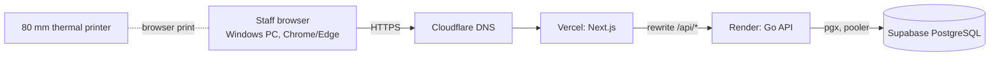

# Zuscar architecture (Stage 1)

Sources: brief v2 sections 2, 5, 6, 8, 10, 12, 17. IDs refer to the brief. Status: design only, nothing here has been built or run.

## 1. Context

Browser never talks to the database. The printer is reached only through the browser (ADR-09, DG-03).

## 2. Runtime components
| Component | Tech | Responsibility |
|---|---|---|
| frontend | Next.js App Router, TS strict, Tailwind v4 | UI, print templates, `/api/*` rewrite (ADR-05). No business rules. |
| backend | Go, Gin, pgx, sqlc | All rules, authorisation, transactions, audit. |
| database | PostgreSQL (Supabase prod, container local) | Constraints, exclusion constraint, ledger trigger, counters. |

## 3. Backend module boundaries
Layout: `backend/internal/<module>/{handler,service,repository}`; shared code in `internal/platform`.

| Module | Owns (tables, brief 8) |
|---|---|
| identity | users, roles, permissions, user_roles, role_permissions, sessions, audit_logs |
| settings | system_settings, document_counters |
| catalogue | categories, products, modifiers, price history |
| orders | orders, order_items, kitchen_tickets, kitchen_ticket_items, tables |
| sales | sales, sale_items, payments, payment_attempts, refunds, idempotency_records, receipt_records |
| shifts | cashier_shifts, cash_movements |
| printing | print_jobs (templates live in frontend) |
| inventory | inventory_items, stock_locations, units_of_measure, unit_conversions, recipes, recipe_items, inventory_movements, stock_counts, stock_count_lines |
| purchasing | suppliers, purchases, purchase_items |
| rooms | room_types, rooms, rate_plans, guests, reservations, stays, housekeeping_tasks, room_status_history |
| folios | guest_folios, folio_items, folio_payments |
| reports | read-only queries, CSV export |
| reconciliation | manual_receipt_reconciliations |
| integrations | tax_invoices, integration_events, provider stubs (gated DG-01, DG-02) |

Rules:
1. A module's repository is used only by its own service. Other modules call its service interface.
2. handler -> service -> repository. Handlers parse, validate and map errors; services hold rules and transactions; repositories hold SQL only (sqlc or plain pgx).
3. `internal/platform` (config, db, logging, http, money, clock) imports no domain module.
4. Cross-module atomic work (sale finalisation touches sales, inventory, folios, identity audit) uses one unit-of-work: the sales service opens the transaction and passes it, via a `Tx` argument, to other services' tx-aware methods. No module commits another module's transaction.
5. Domain modules do not import `reports`; `reports` reads via its own queries.
6. A test (Stage 4) will check import direction with `go list`.

## 4. Request pipeline
request id -> structured log -> panic recovery -> size limit -> session lookup (token hash) -> load permissions from DB -> CSRF check (state-changing) -> rate limit (login) -> idempotency check (money/stock POSTs) -> handler -> permission check in service -> transaction -> audit -> response. Errors use one body: code, message, field errors, request id (10.9).

## 5. Cross-cutting design
- **Money**: BIGINT KES cents; tax rate in basis points from settings; each sale line stores rate and tax amount (7.10, ADR-03).
- **Time**: UTC in storage; Africa/Nairobi for business day, shift and report boundaries via one clock/tz helper.
- **Sale finalisation (10.1)**: one transaction: lock receipt counter row FOR UPDATE, insert sale, line snapshots, payments or due balance, stock movements, audit; commit; then respond. Print later (NN-04, NN-05).
- **Idempotency (10.8)**: see ADR-08.
- **Audit (10.7)**: append-only audit_logs written in the same transaction as the action; no secrets.
- **Auth/RBAC**: ADR-04, ADR-13; Business Manager can never hold system.admin; last active Super Admin protected inside a transaction with a lock.
- **Printing**: ADR-09.
- **Integrations**: provider interface and event persistence only until DG-01/DG-02 are verified (NN-11, NN-12).
- **Observability**: JSON logs with request id; `/healthz` (process), `/readyz` (database ping); error monitoring tool to be chosen at Stage 25 (not decided).

## 6. Frontend structure
`frontend/app` (server components by default), `components/` (Logo.tsx, UI primitives), `lib/api` (fetch client adding CSRF header and Idempotency-Key helper), `lib/money` (display only), `print/` (receipt, kitchen ticket, bill templates: black on white, 80 mm, ~72 mm print width). Permission-aware navigation is cosmetic; the backend decides.

## 7. Non-goals respected
No multi-tenancy, microservices, Kubernetes, offline sync, native apps, or eTIMS/M-Pesa claims (brief 3.2).

## 8. Open design questions (carried to later stages)
- ADR-11 Go toolchain, ADR-12 migration tool, ADR-13 CSRF details: Proposed.
- Stock balance strategy (derived view vs maintained summary): decide at Stage 17.
- Idempotency key retention period default (24 h proposed): confirm.
