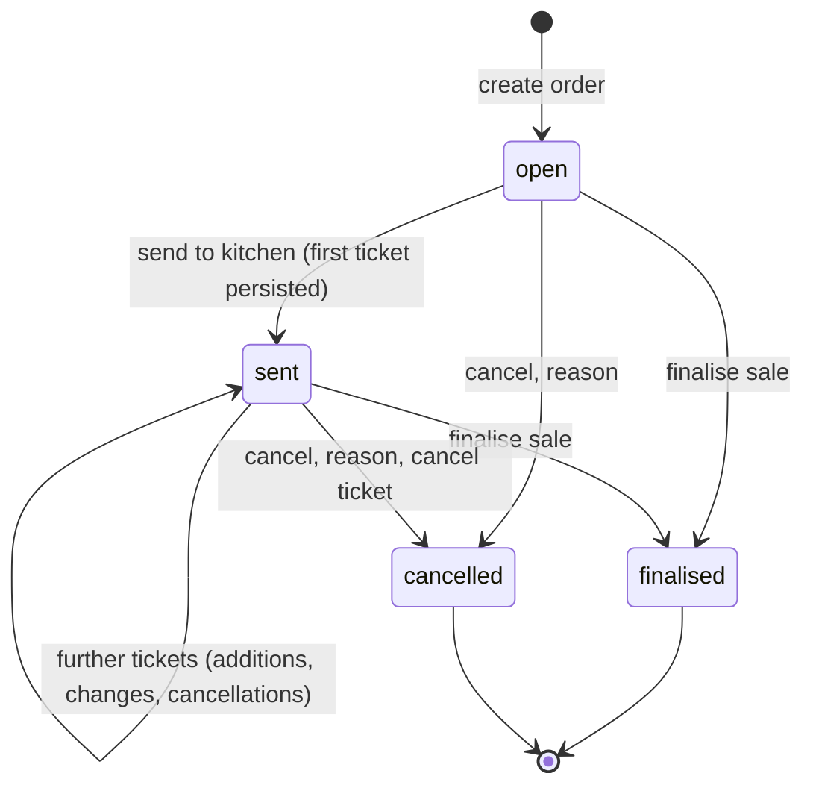
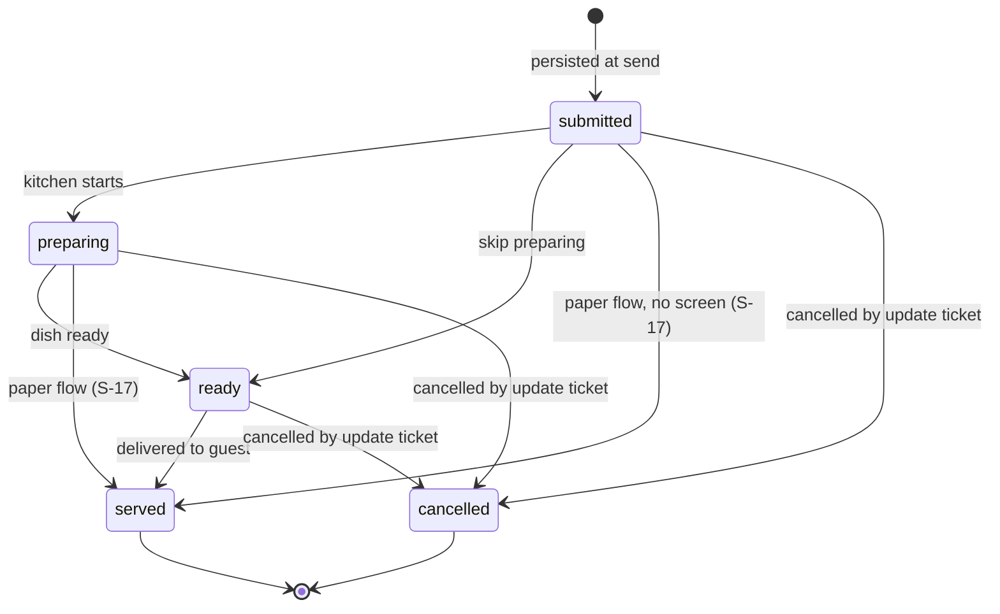
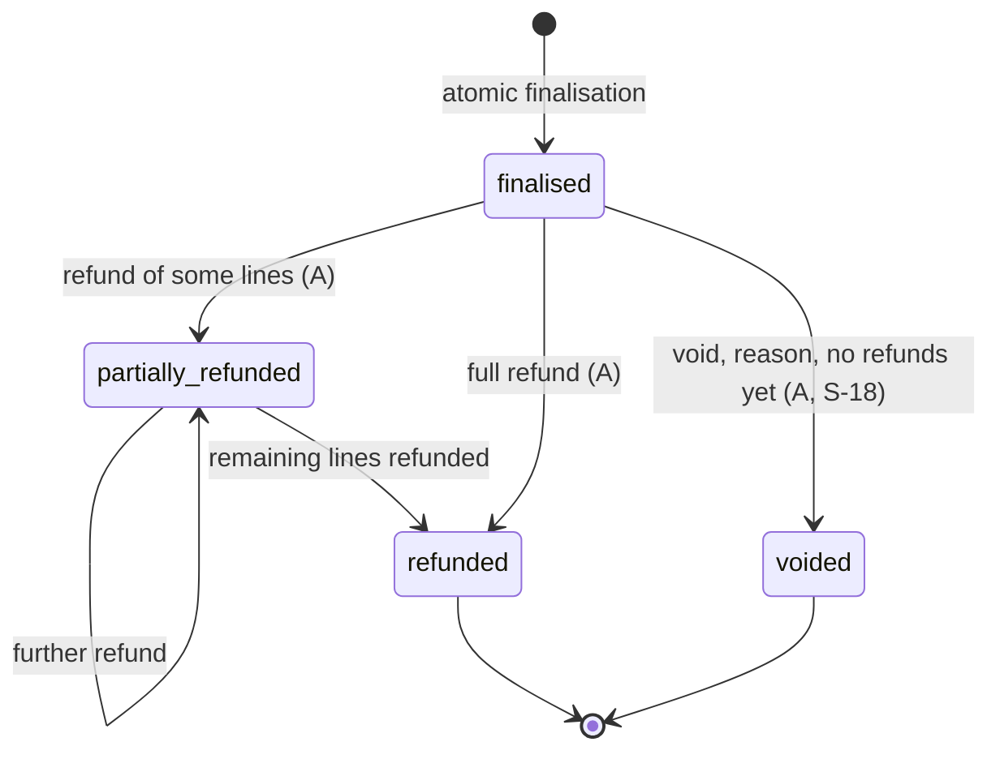
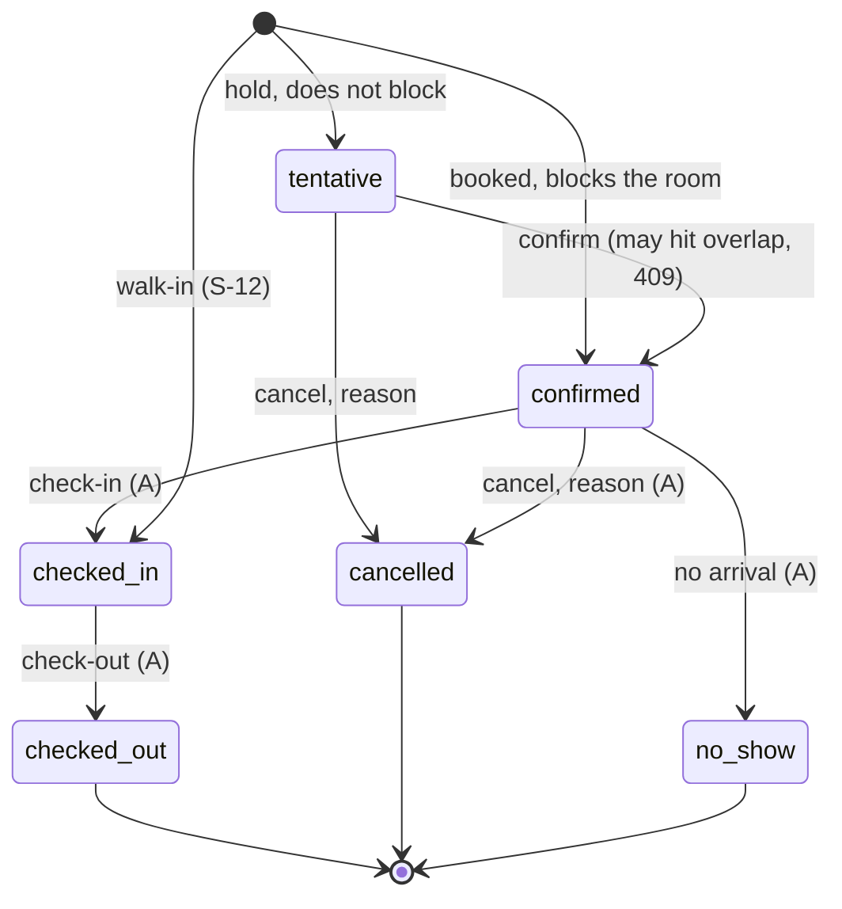
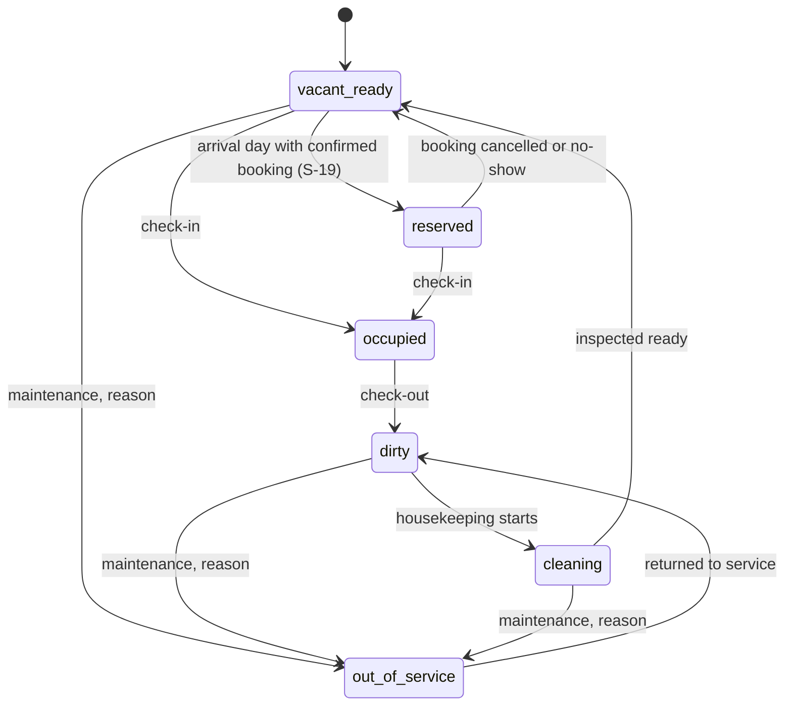
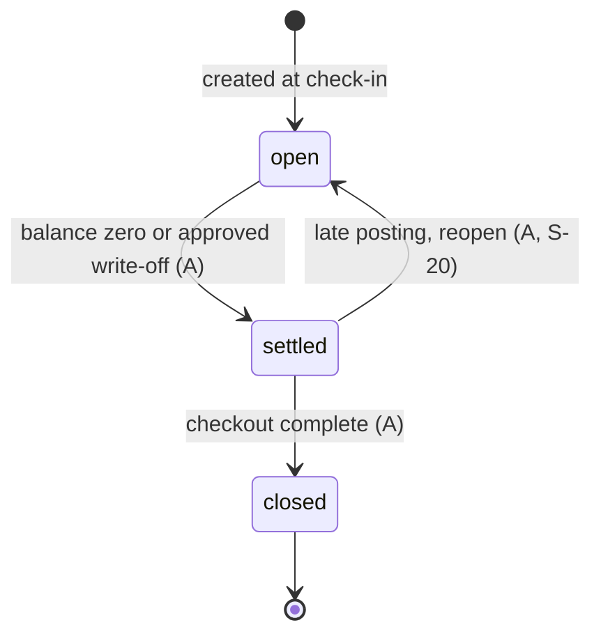
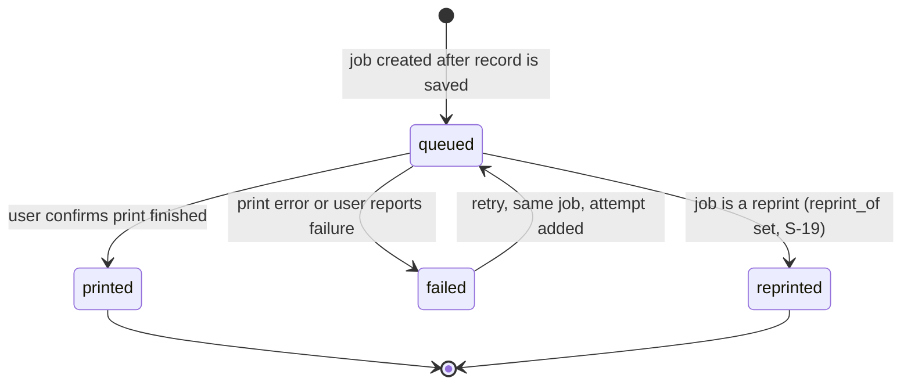
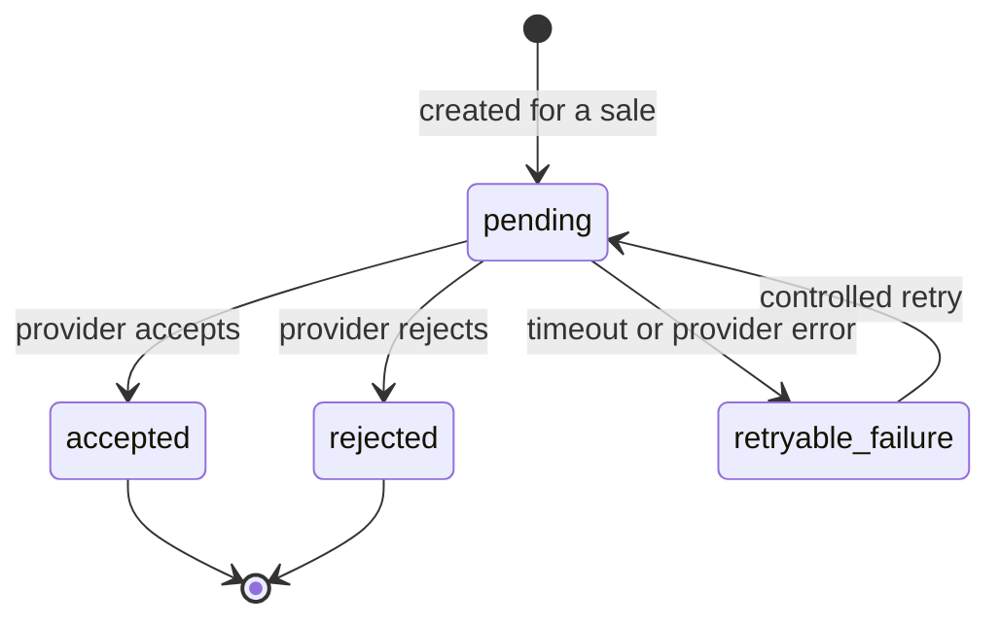
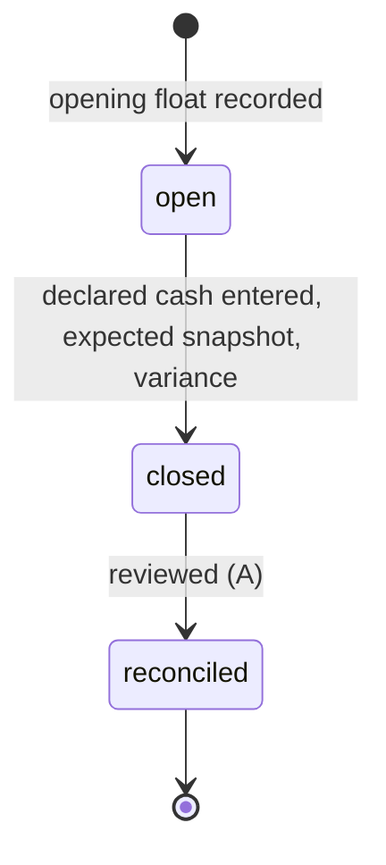

# Behaviour plan: state machines (Stage 3)

Design only. States come from brief section 9; guards and permissions from sections 4, 7 and 10 and from `rbac.md`. Every transition is checked in the Go service, runs in a transaction, and writes an audit row when marked (A). "Illegal" transitions return HTTP 409 with code `invalid_transition`. Any state not drawn is terminal. Proposed rules not in the brief are logged as S-17 to S-21 in ASSUMPTIONS.md.

## 1. Order

| Transition | Permission | Guards and effects |
|---|---|---|
| create | orders.manage | Table required for dine-in. Prices read from server. |
| open to sent | orders.manage | At least one active kitchen-routed item; ticket row and ticket number committed before success (AC-04). Idempotency-Key required. |
| to finalised | sales.create | Single transaction (NN-04); see section 4. Order becomes immutable. |
| to cancelled | orders.manage | Reason required (A). If sent: a cancel update ticket is created so the kitchen is told. Not allowed once a sale exists. |

## 2. Kitchen ticket

Forward-only. Permission `kitchen.update` (Kitchen staff, Waiter, Business Manager). Every change writes ticket_status_history. Ticket status never reads or writes payment status (AC-04). Update tickets (kind = update) carry add, cancel or modify lines and reference the parent ticket; the parent is never edited. Printing is a separate print job (section 8).

## 3. Payment
```mermaid
stateDiagram-v2
  [*] --> confirmed: cash on entry
  [*] --> pending_confirmation: manual M-Pesa, card or bank record
  pending_confirmation --> confirmed: confirmed against statement (A)
  pending_confirmation --> failed: not found or rejected (A)
  confirmed --> reversed: provider reversal only (Stage 24); void and refund add records instead (S-63)
  failed --> [*]
  reversed --> [*]
```
| Transition | Permission | Guards and effects |
|---|---|---|
| create (cash) | sales.create | Confirmed at insert; adds to expected shift cash. Needs an open shift for the actor. |
| create (M-Pesa, card, bank manual) | sales.create | Pending until a permitted user confirms (NN-11, AC-19). Typed reference never counts as collected. Duplicate (method, reference) rejected by partial unique index. |
| to confirmed or failed | payments.reconcile | Actor, time and note recorded. Only pending payments qualify. |
| to reversed | none yet | Reserved for provider reversals (Stage 24). A void or refund leaves the payment as it was and records the money handed back in `refund_payouts` (S-63). |
Collections reports count confirmed payments only (AC-20). Amount, method and target never change after insert (S-10).

## 4. Sale

Finalisation, in one transaction (NN-04, brief 10.1): authenticate and authorise; load order and server prices; check discount permission and reason; check quantities and payment allocation; lock the receipt counter row FOR UPDATE; insert sale and immutable line snapshots with rate and tax; insert payments (cash confirmed, other manual pending) or leave a due balance, or post a folio charge instead (NN-10); insert stock movements for stock-tracked items; mark order finalised; write audit; commit; then respond. Idempotency (key, endpoint, request hash) wraps it. A rollback leaves no receipt number gap (A-05).
Outage entry (Stage 16, S-66 to S-70): a paper receipt written while the system was down is entered once by a holder of `payments.reconcile`. In one transaction the server claims the Idempotency-Key, refuses a paper number already entered, takes the next receipt number, writes the sale (`source` outage_reconciliation, no order, no shift) with its line snapshots and confirmed payments, writes the entry (paper number, when it happened, paper total, who entered it, discrepancy note) and the audit event. A database check makes an outage sale impossible without its entry. The sale then behaves like any other (refunds, reports) except that no receipt is printed for it.
Payment status (separate column, S-08): unpaid, partially_paid, paid, charged_to_folio. Void and refund each add a refund row (kind refund or void) with the lines taken back and the money handed back by method; stock is put back once inventory exists (Stage 17). The original sale, lines and payments are never edited.

## 5. Reservation

Blocking statuses are confirmed and checked_in (DQ-09 default); the exclusion constraint on (room, [check_in, check_out)) rejects any second blocking row, so concurrent attempts cannot both succeed (AC-07, spiked). Overlap violation maps to 409 `room_unavailable`. Check-in needs the room physically vacant_ready or reserved and the date window valid; it creates the stay and the folio. Stay extension is an update of check_out under the same constraint.

Stage 22 builds the part before arrival: making a booking (confirmed, or tentative as a hold), changing it, confirming a hold, cancelling with a reason and marking no-show (from the arrival date on). A change of room or dates is held to the same overlap rule as a new booking. The nightly rate is copied at booking time (S-94). Check-in, the stay and the folio are described below (Stage 23).

## 6. Room (physical status)

Booking status and physical status are separate (brief 7.3). `occupied` rooms cannot go out of service; check-out first. Each change writes room_status_history with actor and reason. Permission rooms.manage (Receptionist, Business Manager).

## 7. Folio

Balance = sum(folio_items) minus confirmed payments on the folio (AC-08). A POS room charge posts a folio_item and never a payment (NN-10). Adjustments and write-offs need folios.manage with Business Manager scope and a reason; corrections are new rows. Closing re-checks the balance inside the transaction.

## 8. Print job

Only the job moves; the sale, ticket and receipt record never change (AC-03, ADR-09). A reprint is a new job linked to the original, rendered from the stored snapshot, carrying a visible REPRINT marker; it needs sales.reprint for receipts. Each attempt is a print_attempts row. "Printed" is the person confirming, since a browser cannot prove paper came out (DG-03).

## 9. Tax invoice (stub, gated by DG-01)

Statuses are extended per provider only after DG-01 is verified. Nothing creates these rows yet and no receipt is called a tax invoice (NN-12, AC-18). Corrections would be credit notes per the verified rules.

## 10. Shift

One open shift per user (partial unique index). Expected cash = float + confirmed cash payments - cash refunds + paid-in - paid-out - expenses, all derived from rows (AC-09). Variance is stored and shown, never absorbed. Close is blocked while the shift has payments awaiting an outstanding required action only if the owner chooses (S-21: default allows close; pending M-Pesa shows as a separate list on the cash-up sheet because it is not cash).

Stock (Stage 17, S-71 to S-77): stock is a ledger of signed movements in each item's base unit, per place; a balance is always the sum, never stored. A person with `inventory.adjust` sets opening stock once per item and place, adjusts with a reason, and reverses a movement with an exact opposite one. Taking stock below zero by hand needs `inventory.override_negative` and a reason (or is refused under the `block` policy). A product linked to an item takes its `stock_units_per_sale` per unit sold, inside the sale's own transaction: bar products from the Bar, the rest from the Kitchen. The link is copied onto each sale line. A retry cannot take stock twice (the idempotency key and a unique index both stop it). A sale on an empty shelf still goes through under the default policy and is flagged; under `block` it is refused. A void puts every line back; a refund puts items back only when asked.

Transfers and wastage (Stage 18, S-78 to S-80): a transfer moves one item between two places as a moved-out and a moved-in movement in one transaction; the source follows the below-zero rule of an adjustment; the database refuses a pair that does not net to zero. A transfer is undone by moving stock back. Wastage, breakage and complimentary stock reduce stock with a mandatory reason and are undone by a reversal.

Purchasing (Stage 19, S-81 to S-84): a purchase is written as a draft (supplier, items, quantities, the invoiced price of one unit) and changes no stock. Receiving it into a place books one receipt per line, with the cost, the person and the time, and closes the purchase; it cannot be received twice, even by two people at once. A cancelled draft books nothing. A wrong receipt is undone by reversing its movement.

Receiving what arrived (Stage 20, S-85 to S-88): the draft keeps the order. At receiving, each line records what really came (a quantity, 0 if it did not) and the price paid, and the stock and cost follow that. Nothing arriving at all is refused. The delivery shows ordered next to arrived, and marks a line whose receipt was later reversed.

Stock counts and low stock (Stage 21, S-89 to S-92): a count is a sheet for one place. Each line holds what was on the shelf and what the books said when it was entered; approving posts only the difference, so sales and deliveries during the count are kept, and a place may end below zero. A draft can be cancelled; an approved count is fixed and is corrected by reversing its movements. The low-stock list shows active items at or under their level, lowest first.

### Check-in, the stay, the folio and room status (Stage 23)

- **Check-in** (rooms.manage, needs an Idempotency-Key): only a confirmed booking, from its arrival date, into a room that is vacant and ready. It makes one stay and one folio and posts a room-night charge for each booked night. The room becomes occupied. A retry returns the same result.
- **The folio** holds charges and adjustments (never edited), and payments (from the payments table, purpose deposit or settlement). Balance = items minus confirmed payments minus any write-off. Pending payments are shown but not counted until confirmed. A charge is not a payment.
- **Taking money** (folios.manage): cash needs the taker's open shift; the amount cannot exceed what is still owed after pending money.
- **Adjustments**: the desk adds charges with a reason; credits and reversing an item, and the write-off, need a manager (`sales.refund`). Each item is reversed once.
- **Extend** (later date only) posts the extra nights and needs the room free; **change room** needs a reason and a ready room, marks the old room dirty and the new one occupied, and keeps the rate.
- **Check-out** (folios.manage): zero balance and no pending payments; closes the folio, ends the stay, marks the booking checked out and the room dirty. **Reopen** a closed folio with a reason for a late charge; **close** it again once settled.
- **Room status by hand**: dirty to cleaning, cleaning to vacant ready, vacant ready or dirty to out of service (reason needed), out of service to dirty. Occupied rooms are changed only by check-out or room change.

### Room charges and housekeeping (Stage 24)

- **Charge to room** (folios.post, Idempotency-Key): an order is sold to the guest in a room. It is a sale with a receipt number and stock taken, stored as charged to the folio, with one charge on the folio for the total (tax inside, as for any sale). The folio must be open and the guest in the house. The guest pays the folio at the desk; the charge is never a payment (NN-10). Corrections are credits on the folio (S-104).
- **Housekeeping**: a room that turns dirty gets one cleaning job. Start moves dirty to cleaning, finish moves cleaning to ready, and moving the room by hand moves the job the same way. Out of service or occupied cancels a waiting job. Maintenance jobs are notes and leave the room alone.
