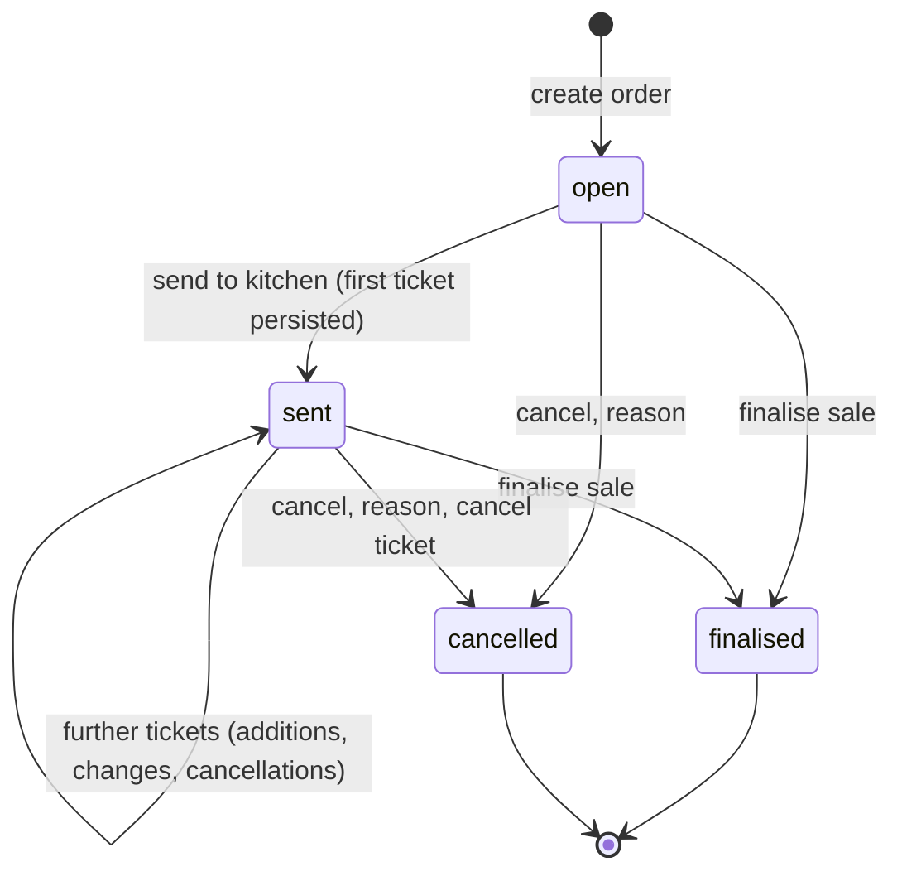
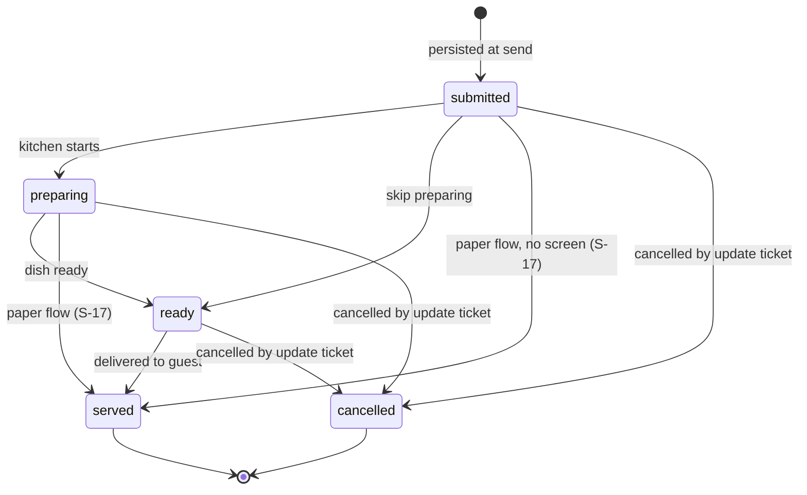
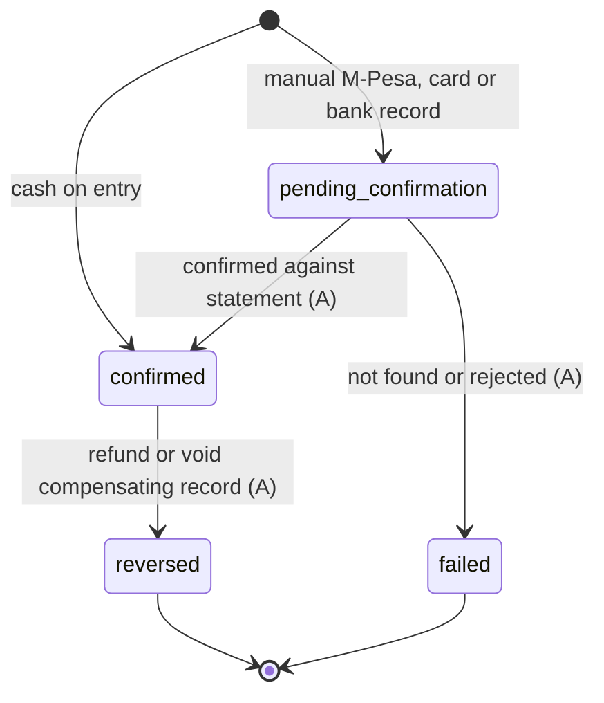
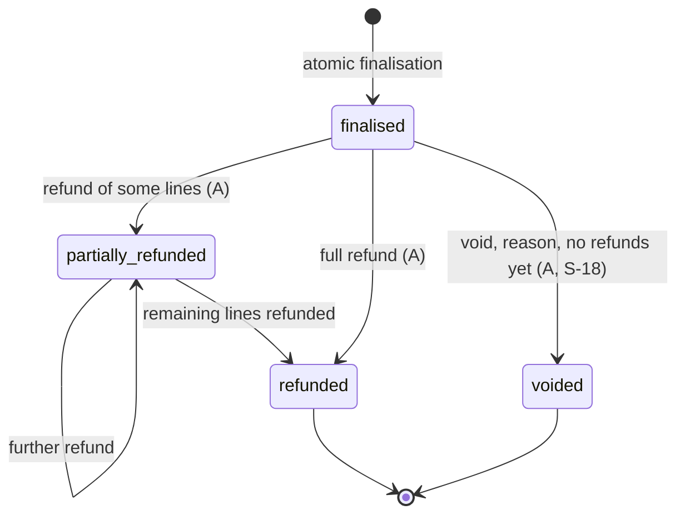
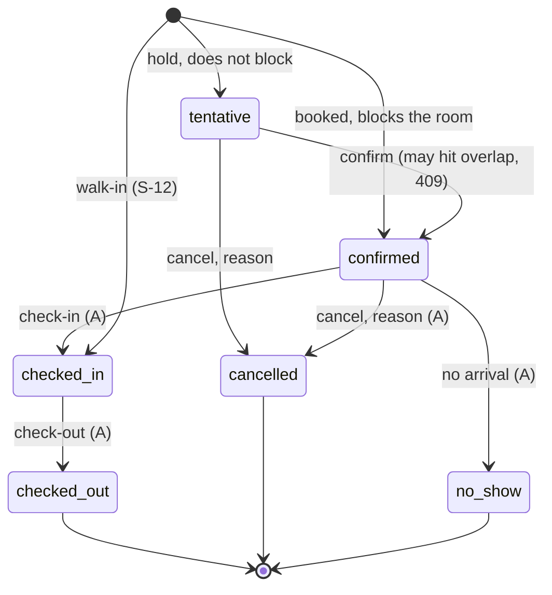
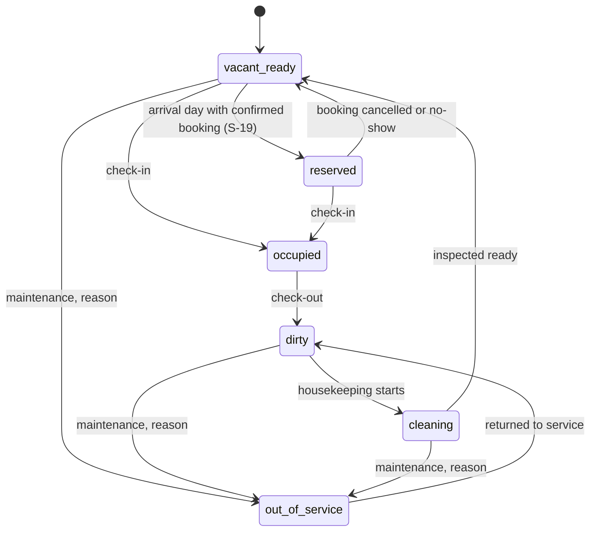
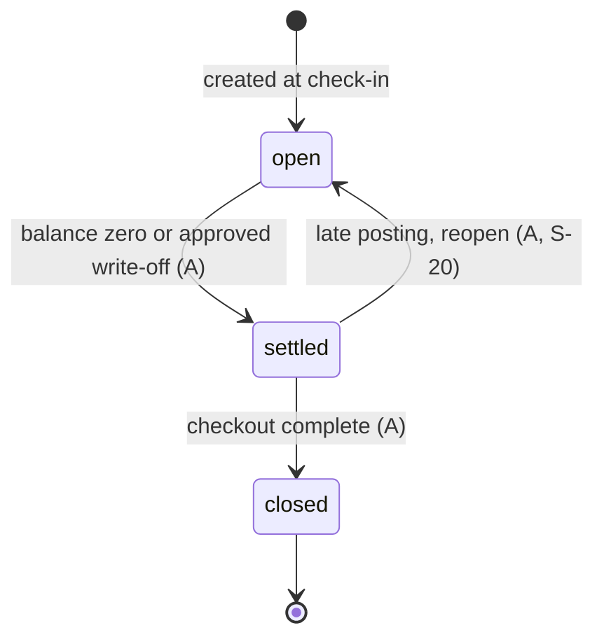
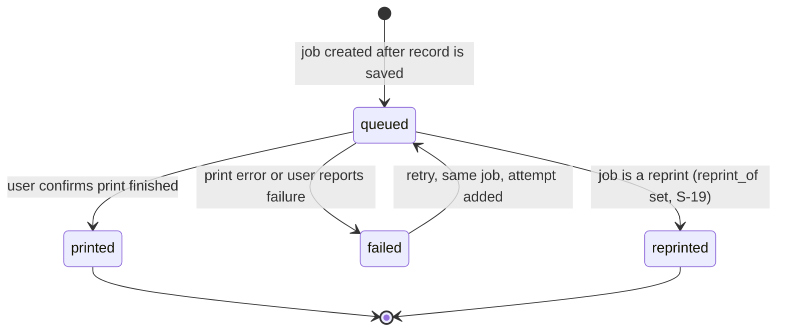
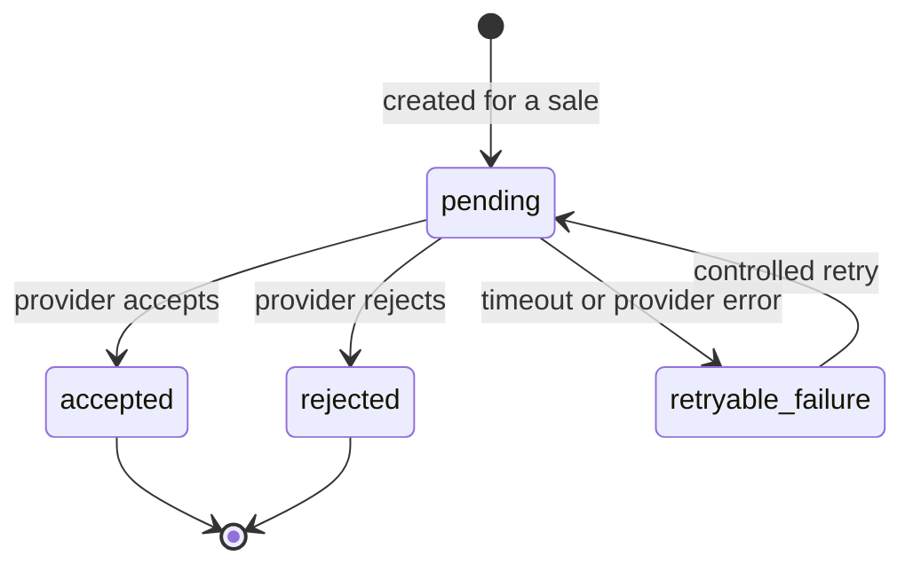
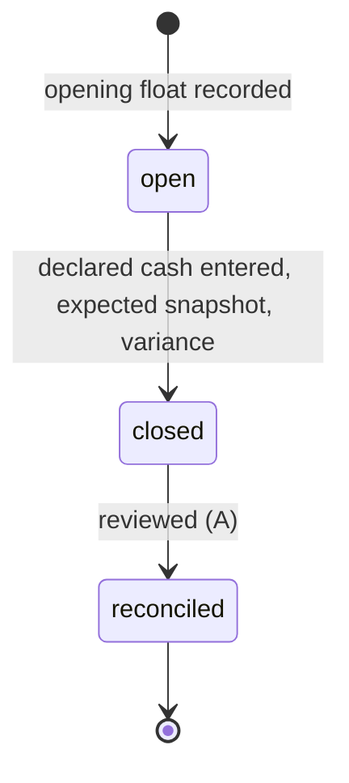

# Behaviour plan: state machines (Stage 3)

Design only. States come from brief section 9; guards and permissions from sections 4, 7 and 10 and from `rbac.md`. Every transition is checked in the Go service, runs in a transaction, and writes an audit row when marked (A). "Illegal" transitions return HTTP 409 with code `invalid_transition`. Any state not drawn is terminal. Proposed rules not in the brief are logged as S-17 to S-21 in ASSUMPTIONS.md.

## 1. Order

| Transition | Permission | Guards and effects |
|---|---|---|
| create | orders.manage | Table required for dine-in. Prices read from server. |
| open to sent | orders.manage | At least one active kitchen-routed item; ticket row and ticket number committed before success (AC-04). Idempotency-Key required. |
| to finalised | sales.create | Single transaction (NN-04); see section 4. Order becomes immutable. |
| to cancelled | orders.manage | Reason required (A). If sent: a cancel update ticket is created so the kitchen is told. Not allowed once a sale exists. |

## 2. Kitchen ticket

Forward-only. Permission `kitchen.update` (Kitchen staff, Waiter, Business Manager). Every change writes ticket_status_history. Ticket status never reads or writes payment status (AC-04). Update tickets (kind = update) carry add, cancel or modify lines and reference the parent ticket; the parent is never edited. Printing is a separate print job (section 8).

## 3. Payment

| Transition | Permission | Guards and effects |
|---|---|---|
| create (cash) | sales.create | Confirmed at insert; adds to expected shift cash. Needs an open shift for the actor. |
| create (M-Pesa, card, bank manual) | sales.create | Pending until a permitted user confirms (NN-11, AC-19). Typed reference never counts as collected. Duplicate (method, reference) rejected by partial unique index. |
| to confirmed or failed | payments.reconcile | Actor, time and note recorded. Only pending payments qualify. |
| to reversed | sales.refund or sales.void | Created by the refund or void service, never directly. |
Collections reports count confirmed payments only (AC-20). Amount, method and target never change after insert (S-10).

## 4. Sale

Finalisation, in one transaction (NN-04, brief 10.1): authenticate and authorise; load order and server prices; check discount permission and reason; check quantities and payment allocation; lock the receipt counter row FOR UPDATE; insert sale and immutable line snapshots with rate and tax; insert payments (cash confirmed, other manual pending) or leave a due balance, or post a folio charge instead (NN-10); insert stock movements for stock-tracked items; mark order finalised; write audit; commit; then respond. Idempotency (key, endpoint, request hash) wraps it. A rollback leaves no receipt number gap (A-05).
Payment status (separate column, S-08): unpaid, partially_paid, paid, charged_to_folio. Void and refund each create compensating payment and stock records plus a refund or void row; the original sale and lines are never edited.

## 5. Reservation

Blocking statuses are confirmed and checked_in (DQ-09 default); the exclusion constraint on (room, [check_in, check_out)) rejects any second blocking row, so concurrent attempts cannot both succeed (AC-07, spiked). Overlap violation maps to 409 `room_unavailable`. Check-in needs the room physically vacant_ready or reserved and the date window valid; it creates the stay and the folio. Stay extension is an update of check_out under the same constraint.

## 6. Room (physical status)

Booking status and physical status are separate (brief 7.3). `occupied` rooms cannot go out of service; check-out first. Each change writes room_status_history with actor and reason. Permission rooms.manage (Receptionist, Business Manager).

## 7. Folio

Balance = sum(folio_items) minus confirmed payments on the folio (AC-08). A POS room charge posts a folio_item and never a payment (NN-10). Adjustments and write-offs need folios.manage with Business Manager scope and a reason; corrections are new rows. Closing re-checks the balance inside the transaction.

## 8. Print job

Only the job moves; the sale, ticket and receipt record never change (AC-03, ADR-09). A reprint is a new job linked to the original, rendered from the stored snapshot, carrying a visible REPRINT marker; it needs sales.reprint for receipts. Each attempt is a print_attempts row. "Printed" is the person confirming, since a browser cannot prove paper came out (DG-03).

## 9. Tax invoice (stub, gated by DG-01)

Statuses are extended per provider only after DG-01 is verified. Nothing creates these rows yet and no receipt is called a tax invoice (NN-12, AC-18). Corrections would be credit notes per the verified rules.

## 10. Shift

One open shift per user (partial unique index). Expected cash = float + confirmed cash payments - cash refunds + paid-in - paid-out - expenses, all derived from rows (AC-09). Variance is stored and shown, never absorbed. Close is blocked while the shift has payments awaiting an outstanding required action only if the owner chooses (S-21: default allows close; pending M-Pesa shows as a separate list on the cash-up sheet because it is not cash).
