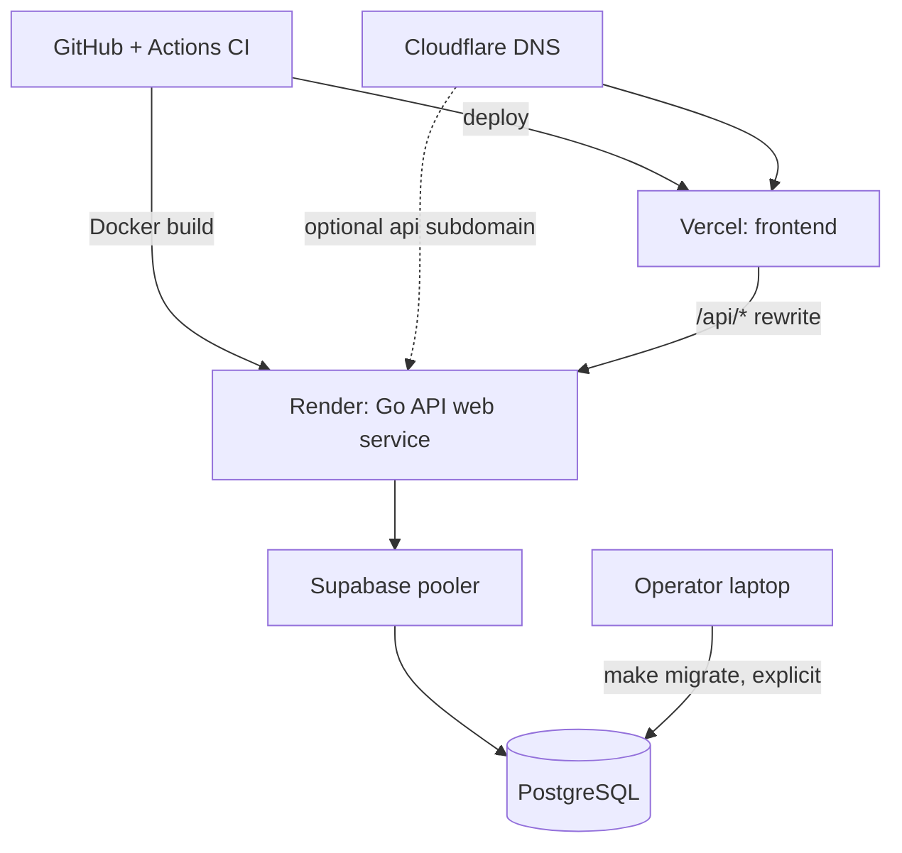

# Deployment topology (Stage 1, design only)

Nothing here was deployed or tested. Items marked UNVERIFIED must be checked against current vendor documentation and a real deployment.

| Component | Host | Notes / things to verify |
|---|---|---|
| Frontend | Vercel | Env: BACKEND_URL, NEXT_PUBLIC_APP_ENV. UNVERIFIED: rewrite keeps cookies, size and timeouts on a preview deploy. |
| API | Render Docker web service, paid always-on for live use (R-03, DG-04) | Health check path `/readyz`. Secrets in Render env. |
| Database | Supabase paid plan for live use (DG-04) | Use only from the API. Session-mode pooler or direct connection preferred; if transaction-mode pooler is used, pgx must run without prepared statements. UNVERIFIED: IPv4/IPv6 Render to Supabase, btree_gist on plan, backup frequency, pausing. |
| DNS/HTTPS | Cloudflare | App subdomain to Vercel; API subdomain optional. Check domain availability and renewal price before buying. |
| Local/CI | Docker Compose in the backend repo: postgres, backend (and a test runner). The frontend runs with `npm run dev`, no Docker (ADR-14) | Production database is never Dockerised (NN-13). |

## Migrations and deploys
Migrations are SQL files in `database/migrations`, run by an explicit command (`make migrate` locally; a documented manual or CI step in production), never at app start (AC-13). Order: backup, migrate, deploy API, deploy frontend. Rollback: forward-fix by default; not every migration is reversible.

## Environments
| | local | CI | production |
|---|---|---|---|
| APP_ENV | development | test | production |
| Database | Compose postgres | service container | Supabase (fresh, never a copy of a test DB) |
| Seed | `make seed-dev` allowed | test fixtures | refused (guard + test) |
| "Test environment" banner | shown | n/a | hidden |

## Environment variables
Names only; values and secrets never committed. `.env.example` (Stage 4) will carry placeholders.

| Variable | Used by | Purpose |
|---|---|---|
| APP_ENV | api, web | development / test / production; drives banner and seed guard |
| API_PORT | api | listen port |
| DATABASE_URL | api, migrate | PostgreSQL connection string |
| TEST_DATABASE_URL | tests | enables DB-dependent tests; unset means they skip loudly |
| LOG_LEVEL | api | log verbosity |
| SESSION_IDLE_TTL, SESSION_ABSOLUTE_TTL | api | session expiry |
| COOKIE_SECURE | api | true except plain-HTTP local dev |
| FRONTEND_URL | api | expected origin for CSRF Origin check |
| LOGIN_MAX_ATTEMPTS, LOGIN_LOCKOUT_WINDOW | api | rate limit and lockout |
| IDEMPOTENCY_TTL | api | key retention |
| MAX_REQUEST_BYTES | api | request size limit |
| BACKEND_URL | web | rewrite target for /api/*; server-side only; read at build time |
| NEXT_PUBLIC_APP_ENV | web | shows the test banner (not a secret) |
| NEXT_PUBLIC_APP_URL | web | the web app's own public URL, used for absolute URLs (not a secret) |
| DB_SIMPLE_PROTOCOL | api, migrate | true behind a transaction-mode pooler |
| PORT | api | provided by Render; used when API_PORT is unset |

Not env vars: first Super Admin credentials. The bootstrap command takes them at run time (prompt or stdin), never from source (prompt section 8).
