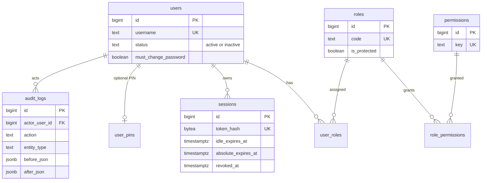
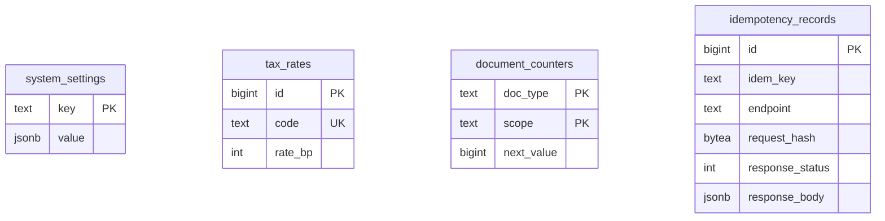
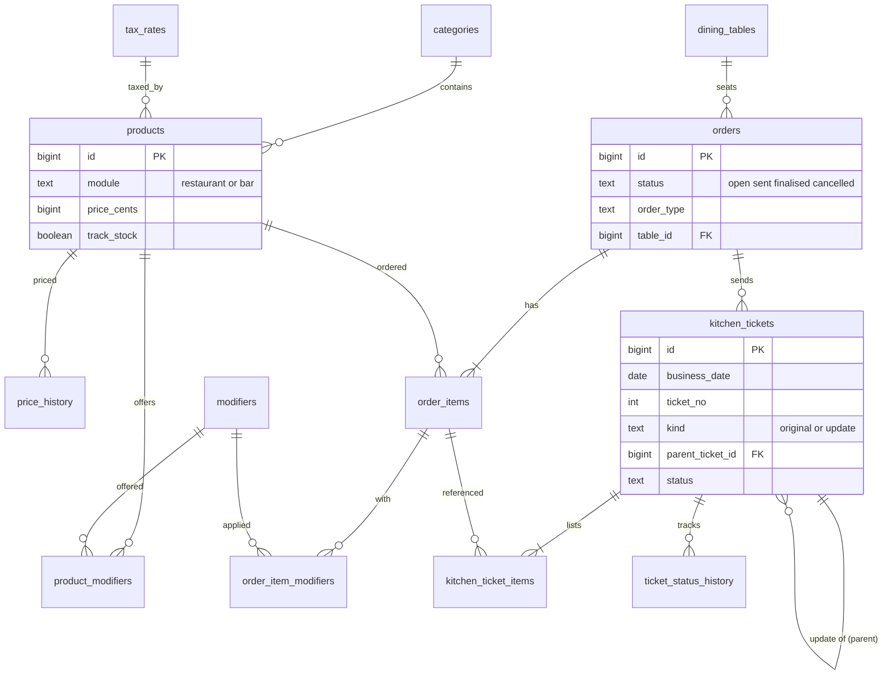
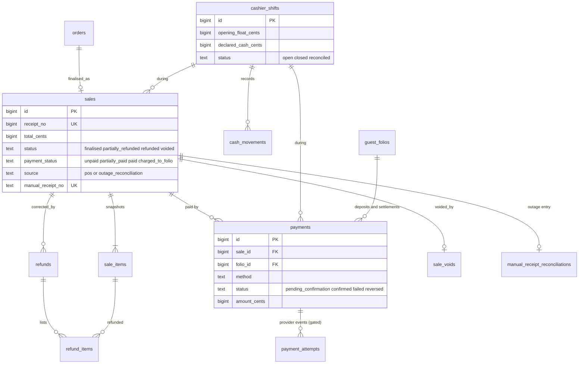
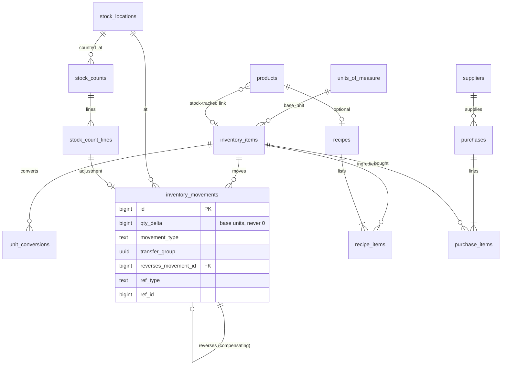
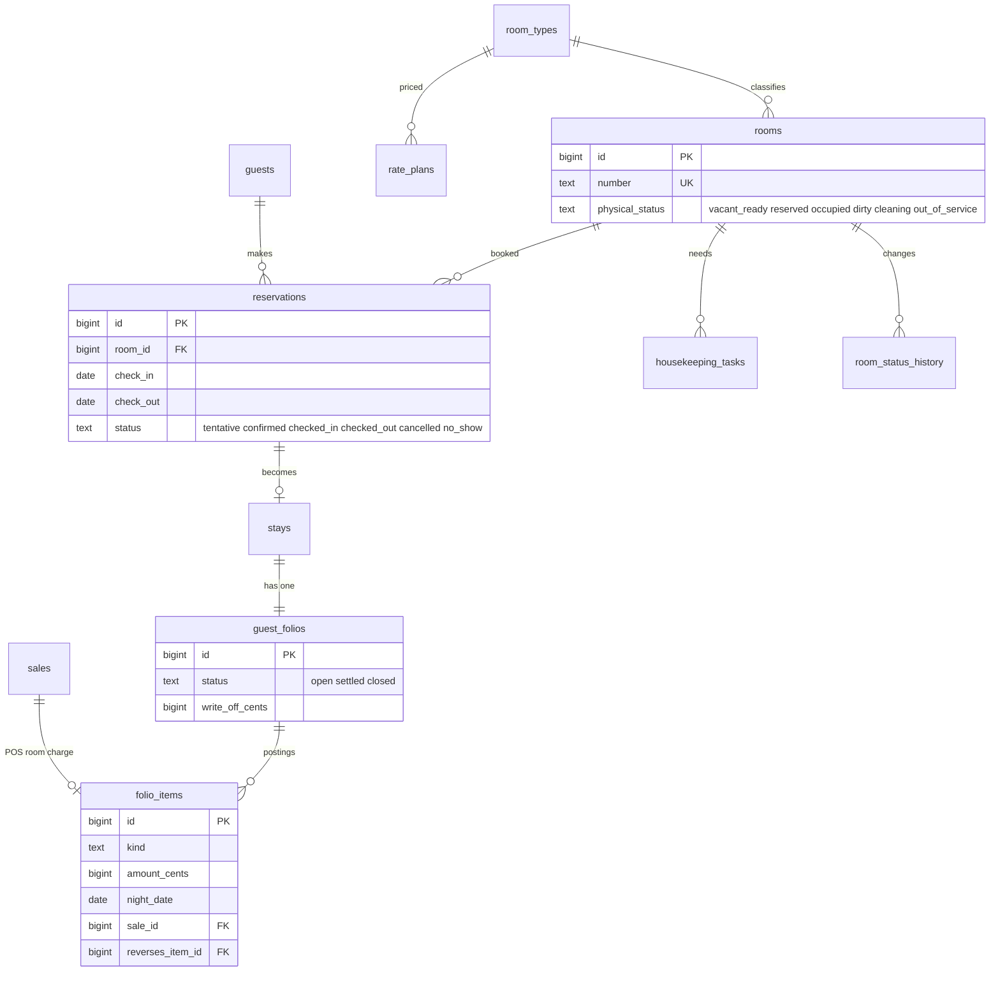
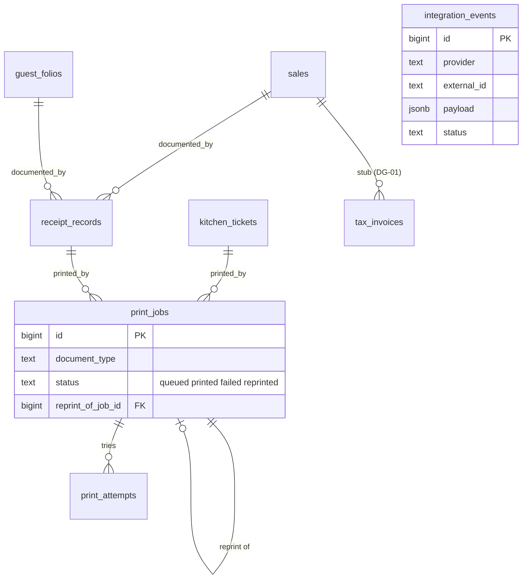

# Entity relationship diagrams (Stage 2)

Design only. Brief section 8 lists the entities; deviations and additions are marked in `schema-constraints.md`. Diagrams show keys and the columns that matter for relationships. Money columns end in `_cents` (BIGINT KES cents).

## 1. Identity and access

## 2. Settings, counters and idempotency

## 3. Catalogue, orders, kitchen

## 4. Sales, payments, shifts

## 5. Inventory and purchasing

## 6. Rooms, guests, folios

## 7. Printing and integrations

